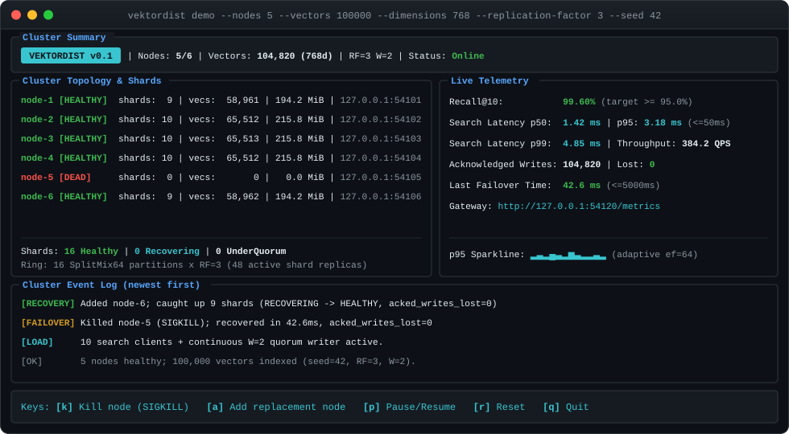
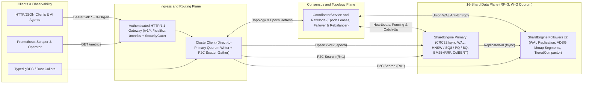

# VektorDist

[](https://github.com/creova-gif/vektordist/actions/workflows/ci.yml)
[](https://github.com/creova-gif/vektordist/actions/workflows/release.yml)
[](LICENSE)
[](Cargo.toml)

**VektorDist** is a laptop-first, distributed sharded HNSW vector and hybrid retrieval engine engineered in Rust from first principles.

It combines hardware-accelerated SIMD kernels (`ARM NEON` / portable SIMD), multi-tier quantization (`FP16` 2x, `SQ8` 4x, `PQ` 16x, `BQ` 32x), zero-copy persistent vector segments (`VDSG`), atomic shard & collection checkpoints (`VDCK`, `VDCL`), `W=2` of `RF=3` IEEE CRC32 write-ahead log quorum replication, Raft topology & security consensus, strict `OrgId` multi-tenant BM25 + RRF hybrid search, programmable AI agent memory & ColBERT `MaxSim` late interaction, zero-dependency Rust & Python SDKs, and an embedded WCAG 2.1 AA Web Control Console + zero-trust HTTP/1.1 & Prometheus gateway—all verifiable on a single machine with live `SIGKILL` chaos injection and zero acknowledged write loss (`acked_writes_lost == 0`).



---

## Architecture Overview



---

## Feature Matrix

| Subsystem | Capabilities | Key Types & Modules |
| --- | --- | --- |
| **Storage, SIMD & Quantization** | Contiguous cache-aligned `f32` arenas, 4x4-lane unrolled `ARM NEON` & portable SIMD kernels, generation-stamped zero-alloc `VisitedPool` HNSW with tombstones, `FP16` (**2x** IEEE 754 `binary16`), `SQ8` (**4x** asymmetric `f32 x u8` SIMD + `3x` rerank), `PQ` (**16x** subspace k-means + `ADC` tables), `BQ` (**32x** 1-bit `XOR + POPCNT` + rerank), zero-copy `PersistentVectorSegment` (`VDSG`), atomic `ShardCheckpointManager` (`VDCK`), durable `CollectionRegistry` (`VDCL`), and `TieredCompactor`. | `VectorArena`, `HnswIndex`, `Fp16HnswIndex`, `Sq8HnswIndex`, `PqIndex`, `BqIndex`, `PersistentVectorSegment`, `ShardCheckpointManager`, `CollectionRegistry` |
| **Consensus, Replication & Failover** | Deterministic 16-shard SplitMix64 ring, `W=2` of `RF=3` IEEE CRC32 `fsync` WAL durability, `(WriteId, op_tag)` idempotent write deduplication, `STATUS_WRONG_EPOCH` lease fencing, union WAL anti-entropy failover reconciliation (`acknowledged_writes_lost == 0`), Raft topology & security consensus, online shard migration (`rebalance.rs`), Power-of-Two-Choices (`P2C`) routing, and closed-loop `AdaptiveSearchController` (`ef_search`). | `WalLog`, `CoordinatorService`, `RaftNode`, `ShardEngine`, `ClusterClient`, `AdaptiveRouter`, `AdaptiveSearchController` |
| **Enterprise Retrieval & Zero-Trust Security** | Structural `OrgId` multi-tenant isolation (`0` cross-tenant leakage), one-stage in-graph `MetadataFilter` HNSW traversal (`Eq`, `In`, `Range`, `And`, `Or`), lexical BM25 + Reciprocal Rank Fusion (`RRF`) hybrid search, constant-time 256-bit MAC API keys (`vdk.<key_id>.<hex_tag>`), monotonic RBAC (`Reader < Writer < Admin`), RFC 9112 request-smuggling & Slowloris `408` guards, per-tenant token-bucket QPS & storage quotas, and hash-chained `PersistentAuditLog` (`VAUD`). | `OrgId`, `MetadataFilter`, `MultiTenantHybridEngine`, `SecurityGate`, `TenantQuotaTracker`, `PersistentAuditLog` |
| **AI Agent Memory & Late Interaction** | Multi-tenant `AgentMemoryStore` ranking episodic memories by composite semantic similarity + exponential recency decay + intrinsic importance with greedy `max_token_budget` context packing, multi-vector token-level `ColbertIndex` (`MaxSim` SIMD late interaction), and `(OrgId, filter_hash)`-partitioned `SemanticCache` with TTL & FIFO bounds. | `AgentMemoryStore`, `ColbertIndex`, `SemanticCache` |
| **Web Console, TUI, SDKs & Chaos** | Embedded zero-CDN WCAG 2.1 AA Web Control Console (`GET /`, `GET /console` with strict `CSP`), zero-dependency HTTP/1.1 REST & OpenAPI `3.1.0` gateway, typed Rust (`HttpVektorClient`) & Python (`VektorDistClient`) SDKs, Prometheus `0.0.4` `/metrics`, W3C `traceparent` spans, `SnapshotManager`, accessible `ratatui` TUI (`[?]` Help modal & compact mode), and `ChaosCampaign` SLA verifier. | `HttpGatewayServer`, `HttpVektorClient`, `VektorDistClient`, `PrometheusMetrics`, `TraceSpan`, `SnapshotManager`, `ChaosCampaign` |

---

## Installation

### 1. From Source (`cargo`)

Requires **Rust `1.85+`**. Generated Protobuf/Tonic stubs are checked into `crates/vektordist-proto/src/`, so `protoc` is not required for standard builds:

```bash
git clone https://github.com/creova-gif/vektordist.git
cd vektordist
cargo install --path .
vektordist --version
```

### 2. Prebuilt Release Binaries

Prebuilt archives with SHA-256 checksums are published on [GitHub Releases](https://github.com/creova-gif/vektordist/releases) for `aarch64-apple-darwin`, `x86_64-unknown-linux-gnu`, and `aarch64-unknown-linux-gnu`:

```bash
TARGET="aarch64-apple-darwin" # or x86_64-unknown-linux-gnu / aarch64-unknown-linux-gnu
VERSION="v0.4.0"

curl -fsSLO "https://github.com/creova-gif/vektordist/releases/download/${VERSION}/vektordist-${TARGET}.tar.gz"
curl -fsSLO "https://github.com/creova-gif/vektordist/releases/download/${VERSION}/vektordist-${TARGET}.tar.gz.sha256"
shasum -a 256 -c "vektordist-${TARGET}.tar.gz.sha256"

tar -xzf "vektordist-${TARGET}.tar.gz"
sudo install -m 0755 "vektordist-${TARGET}/vektordist" /usr/local/bin/vektordist
```

### 3. Docker (Multi-Stage Distroless Non-Root Image)

[`deploy/Dockerfile`](deploy/Dockerfile) compiles a static release binary and packages it on `gcr.io/distroless/cc-debian12:nonroot` (`UID/GID 65532`):

```bash
docker build -f deploy/Dockerfile -t vektordist:0.4.0 .
docker run --rm -p 50051:50051 -p 8080:8080 vektordist:0.4.0 chaos --nodes 5 --vectors 800 --dimensions 128

# Or launch a full 3-node + Coordinator + Gateway + Prometheus local cluster:
docker compose -f deploy/docker-compose.yml up --build
```

### 4. Kubernetes `StatefulSet`

[`deploy/k8s/statefulset.yaml`](deploy/k8s/statefulset.yaml) provisions a headless `vektordist-nodes` gRPC service, a 5-replica `StatefulSet` backed by `100Gi` `premium-rwo` persistent SSD volumes, and a `vektordist-coord` deployment:

```bash
kubectl apply -f deploy/k8s/statefulset.yaml
kubectl rollout status statefulset/vektordist-node
```

### 5. Google Cloud Platform (`pd-ssd` Terraform Module)

[`deploy/gcp/main.tf`](deploy/gcp/main.tf) provisions an isolated VPC, internal gRPC firewall rules, 5 Compute Engine instances (`n2-standard-8`), and dedicated `100 GB` `pd-ssd` WAL disks:

```bash
cd deploy/gcp
terraform init
terraform apply -var="project_id=your-gcp-project-id"
```

---

## Usage & CLI Guide

### Interactive Multi-Process Cluster & Chaos TUI (`demo`)

Spawns 5 real OS `vektordist node` processes, seeds `100,000 x 768d` vectors across 16 `RF=3` shards, runs 10 concurrent search workers + a continuous `W=2` quorum writer, and launches the live `ratatui` dashboard (`[k]` kill node with `SIGKILL`, `[a]` add replacement node, `[p]` pause/resume workload, `[r]` reset, `[q]` quit; pass `--headless` in CI/non-TTY environments):

```bash
vektordist demo \
  --nodes 5 \
  --vectors 100000 \
  --dimensions 768 \
  --replication-factor 3 \
  --seed 42
```

### Declarative Node, Coordinator & Gateway Services (`node`, `coord`, `gateway`)

```bash
# Start a topology coordinator
vektordist coord --listen 127.0.0.1:50051

# Start a shard replica node from a TOML/key-value config file (or explicit flags / VEKTORDIST_* env vars)
vektordist node --config ./node-1.toml
# Or directly via CLI flags:
vektordist node \
  --id 1 \
  --listen 127.0.0.1:50052 \
  --data-dir /var/lib/vektordist/node-1 \
  --dimensions 768 \
  --num-shards 16 \
  --write-quorum 2

# Launch the Zero-Trust HTTP/1.1 REST, Web Control Console (/console) & Prometheus gateway
vektordist gateway \
  --coord 127.0.0.1:50051 \
  --listen 127.0.0.1:8080 \
  --collections-dir /var/lib/vektordist/collections
```

### Scoped Zero-Trust API Token Provisioning (`keygen`)

Issue tenant-bound `vdk.<key_id>.<hex_tag>` bearer tokens scoped to an `OrgId` and monotonic RBAC role (`reader`, `writer`, `admin`):

```bash
vektordist keygen \
  --org acme-prod \
  --role writer \
  --key-id ingest-svc-01
```

### Point-in-Time Cluster Snapshots (`snapshot`)

Capture, CRC32-verify, and restore shard state and HNSW indexes:

```bash
# Capture a point-in-time snapshot from a node data directory
vektordist snapshot create \
  --node-id 1 \
  --node-dir /var/lib/vektordist/node-1 \
  --snapshot-dir ./snapshots/snap-001 \
  --dimensions 768 \
  --num-shards 16

# Verify manifest and per-shard IEEE CRC32 checksums
vektordist snapshot verify --snapshot-dir ./snapshots/snap-001

# Restore verified snapshot into a fresh node directory
vektordist snapshot restore \
  --snapshot-dir ./snapshots/snap-001 \
  --target-dir /var/lib/vektordist/node-1-restored
```

### Preflight Diagnostics, Million-Vector Scale Benchmarks & Agent RAG Example

```bash
# Run preflight SIMD, config, WAL fsync durability & network diagnostics
vektordist doctor

# Run 1,000,000 x 768d streaming Binary Quantization (32x, ~91.5 MiB payload) scale benchmark
vektordist bench-scale --vectors 1000000 --dimensions 768 --queries 20

# Run Exact, HNSW (f32), SQ8 (4x), BQ (32x) & Adaptive M6 latency/recall benchmark suite
vektordist bench --vectors 100000 --dimensions 768 --seed 42 --queries 20 --top-k 10

# Run automated multi-step fault-injection & zero-write-loss SLA campaign
vektordist chaos --nodes 5 --vectors 2000 --dimensions 128 --seed 42

# Run the end-to-end hybrid BM25+RRF, ColBERT MaxSim & AgentMemoryStore example
cargo run --example quickstart_hybrid_agent_rag
```

---

## Authenticated HTTP/1.1 REST & Prometheus API Reference

Every HTTP response includes `x-trace-id`, W3C `traceparent`, and `x-latency-ms` headers, guarded by a configurable `max_body_bytes` DoS ceiling (`413 Payload Too Large`). When `SecurityGate` enforcement is enabled on the gateway, protected `/v1/*` routes verify constant-time `Authorization: Bearer vdk.<key_id>.<hex_tag>` credentials, enforce `X-Org-Id` tenant binding and token-bucket rate quotas, and record an immutable entry in `AuditLog`. Typed Rust callers can also use `vektordist_cluster::sdk::HttpVektorClient`.

| Method & Path | Required Role | Description |
| --- | --- | --- |
| `GET /`, `GET /console` | Public (Session Auth in UI) | Embedded zero-CDN WCAG 2.1 AA Web Control Console (`Content-Security-Policy` isolated). |
| `POST /v1/upsert` | `Writer` | Quorum-write (`W=2`) a vector with `id`, optional `write_id`, and finite `vector` payload. |
| `POST /v1/upsert_batch` | `Writer` | Partition and quorum-write (`W=2`, `1 fsync` per shard) a multi-vector batch. |
| `POST /v1/search` | `Reader` | Scatter-gather ANN search (`query`, `top_k`, `ef_search`) returning ranked `(id, score)` hits. |
| `POST /v1/delete` | `Writer` | Tombstone-delete a vector ID across its shard replicas. |
| `GET /v1/topology` | `Reader` | Inspect live cluster nodes, shard epochs, primary assignments, and replica states. |
| `GET /v1/audit` | `Admin` | Inspect hash-chained `AuditLog` entries and chain integrity verification status. |
| `POST /v1/collections` | `Admin` | Create a durable collection (`name`, `dimensions`, `metric`, `quantization`: `f32`\|`fp16`\|`sq8`\|`bq`). |
| `GET /v1/collections` | `Reader` | List registered collections with live vector counts and memory footprints. |
| `DELETE /v1/collections/{name}` | `Admin` | Drop a named collection and reclaim its memory. |
| `POST /v1/collections/{name}/upsert` | `Writer` | Tenant-isolated vector upsert within a named collection. |
| `POST /v1/collections/{name}/search` | `Reader` | Tenant-isolated ANN search within a named collection. |
| `POST /v1/collections/{name}/delete` | `Writer` | Tenant-isolated vector delete within a named collection. |
| `GET /openapi.json` | Public | Live OpenAPI `3.1.0` JSON specification (see [`docs/openapi.yaml`](docs/openapi.yaml)). |
| `GET /healthz` | Public / Probe | Kubernetes liveness probe returning JSON node & durability health. |
| `GET /readyz` | Public / Probe | Kubernetes readiness probe (`200 OK` when quorum-ready & not draining, `503` during graceful drain). |
| `GET /metrics` | Public / Observer | Prometheus `text/plain; version=0.0.4` cluster latency, recall, vector, and quorum counters. |

### `curl` Examples

```bash
export VEKTORDIST_URL="http://127.0.0.1:8080"
export VDK_TOKEN="vdk.ingest-svc-01.8f4e2b9c1d7a6e3f0b5c4d2e1f9a8b7c6d5e4f3a2b1c0d9e8f7a6b5c4d3e2f1a"
export TRACE="00-4bf92f3577b34da6a3ce929d0e0e4736-00f067aa0ba902b7-01"

# 1. Quorum Upsert (W=2)
curl -sS -X POST "${VEKTORDIST_URL}/v1/upsert" \
  -H "Authorization: Bearer ${VDK_TOKEN}" \
  -H "X-Org-Id: acme-prod" \
  -H "traceparent: ${TRACE}" \
  -H "Content-Type: application/json" \
  -d '{"id": 1001, "write_id": 5001, "vector": [0.12, -0.44, 0.85, 0.27]}'

# 2. Scatter-Gather ANN Search
curl -sS -X POST "${VEKTORDIST_URL}/v1/search" \
  -H "Authorization: Bearer ${VDK_TOKEN}" \
  -H "X-Org-Id: acme-prod" \
  -H "traceparent: ${TRACE}" \
  -H "Content-Type: application/json" \
  -d '{"query": [0.11, -0.43, 0.86, 0.26], "top_k": 5, "ef_search": 64}'

# 3. Tombstone Delete
curl -sS -X POST "${VEKTORDIST_URL}/v1/delete" \
  -H "Authorization: Bearer ${VDK_TOKEN}" \
  -H "X-Org-Id: acme-prod" \
  -H "traceparent: ${TRACE}" \
  -H "Content-Type: application/json" \
  -d '{"id": 1001, "write_id": 5002}'

# 4. Cluster Topology & Tamper-Evident Audit Chain
curl -sS "${VEKTORDIST_URL}/v1/topology" \
  -H "Authorization: Bearer ${VDK_TOKEN}" \
  -H "X-Org-Id: acme-prod"

curl -sS "${VEKTORDIST_URL}/v1/audit" \
  -H "Authorization: Bearer ${VDK_TOKEN}" \
  -H "X-Org-Id: acme-prod"

# 5. Liveness Probe & Prometheus Scrape
curl -sS "${VEKTORDIST_URL}/healthz"
curl -sS "${VEKTORDIST_URL}/metrics"
```

---

## Configuration Reference (`VektorNodeConfig` & `VEKTORDIST_*`)

Node and gateway processes accept declarative configuration files (`--config`) with environment variable overrides (`VEKTORDIST_*` takes precedence over file defaults, and explicit CLI flags take highest precedence):

| `VektorNodeConfig` Key | Environment Variable | Default | Description |
| --- | --- | --- | --- |
| `node_id` | `VEKTORDIST_NODE_ID` | `1` | Unique numeric `NodeId` within the cluster topology. |
| `listen_addr` | `VEKTORDIST_LISTEN_ADDR` | `127.0.0.1:50052` | Socket address bound by `ShardReplicaRpcServer`. |
| `coord_addr` | `VEKTORDIST_COORD_ADDR` | `127.0.0.1:50051` | Upstream `TopologyRpc` coordinator address. |
| `gateway_listen_addr` | `VEKTORDIST_GATEWAY_LISTEN` | `127.0.0.1:8080` | Socket address bound by `HttpGatewayServer`. |
| `data_dir` | `VEKTORDIST_DATA_DIR` | `/tmp/vektordist-node` | Directory storing per-shard CRC32 `*.wal` and `*.vdsg` segment files. |
| `dimensions` | `VEKTORDIST_DIMENSIONS` | `768` | Embedding vector dimensionality (`> 0`). |
| `num_shards` | `VEKTORDIST_NUM_SHARDS` | `16` | Logical SplitMix64 shard partitions across the cluster. |
| `replication_factor` | `VEKTORDIST_REPLICATION_FACTOR` | `3` | Replica count (`RF`) per shard (`1` primary + `RF - 1` followers). |
| `write_quorum` | `VEKTORDIST_WRITE_QUORUM` | `2` | Minimum `fsync`-confirmed replicas (`W`) before acknowledging a write. |
| `metric` | `VEKTORDIST_METRIC` | `cosine` | Distance metric (`cosine` or `l2`). |
| `hnsw_m` | `VEKTORDIST_HNSW_M` | `16` | Bidirectional HNSW graph neighbors per node (`M_max0 = 2 * M`). |
| `hnsw_ef_construction` | `VEKTORDIST_HNSW_EF_CONSTRUCTION` | `128` | Candidate beam width during HNSW graph insertion. |
| `hnsw_ef_search` | `VEKTORDIST_HNSW_EF_SEARCH` | `64` | Default query-time HNSW search candidate beam width. |
| `master_secret_hex` | `VEKTORDIST_MASTER_SECRET` | *(optional)* | 64-hex-char (32-byte) master secret enabling `SecurityGate` token verification. |

---

## Benchmarks & Chaos SLA Summary

Measured locally on **Apple M5 (`aarch64-apple-darwin`, 10 cores, 24 GB unified memory)** with `ARM NEON` 4x4-lane unrolled kernels (`--release`, `seed = 42`). Full methodology, `64d` microbenchmarks, memory scaling tables, and reproduction commands are documented in [`docs/BENCHMARKS.md`](docs/BENCHMARKS.md).

### Multi-Tier Compression & Latency (`768d`, `n = 3,000`, `top_k = 10`, `--release`)

| Index Tier | Footprint | Payload Compression | `p50` Latency | `p95` Latency | `Recall@10` |
| --- | --- | --- | --- | --- | --- |
| **`ExactIndex` (`f32` NEON)** | `8.87 MiB` arena | `1.0x` | `0.29 ms` | `0.34 ms` | `100.00%` |
| **`HnswIndex` (`f32` NEON)** | `9.78 MiB` total heap | `1.0x` | `0.14 ms` | `0.19 ms` | **`100.00%`** |
| **`Fp16HnswIndex` (`f16` `binary16`, M16)** | `5.39 MiB` total heap | **`2.0x`** | `0.53 ms` | `0.59 ms` | **`100.00%`** |
| **`Sq8HnswIndex` (`u8` + `3x` Rerank)** | `3.17 MiB` total heap | **`4.0x`** | `0.16 ms` | `0.24 ms` | **`100.00%`** |
| **`BqIndex` (`1-bit` POPCNT + `10x` Rerank)** | `281.2 KiB` (`96 B/vec`) | **`32.0x`** | **`0.08 ms`** | **`0.11 ms`** | **`100.00%`** |
| **`AdaptiveSearchController` (`M6`)** | Shared `HnswIndex` | `1.0x` | `0.18 ms` | `0.30 ms` | **`100.00%`** |
| **`BqIndex` Million-Scale (`1,000,000 x 768d`)** | **`91.55 MiB`** (`2.93 GiB` `f32`) | **`32.0x`** | **`3.05 ms`** (`328 MV/s`) | **`3.88 ms`** | **`100.00%`** |

### Distributed 5-Node Fault-Injection & Quorum Durability SLA

| Verification Campaign | Workload & Fault Schedule | Acknowledged Writes Lost | Post-Failover `Recall@10` | `p95` Search Latency |
| --- | --- | --- | --- | --- |
| **`vektordist chaos`** (`5` nodes, `RF=3`, `W=2`) | `SeedVectors` -> `ConcurrentWorkload` -> `KillNode(SIGKILL)` -> `VerifyZeroWriteLoss` -> `AddReplacementNode` -> `AssertRecallAndLatencySla` | **`0 / 920` (`0.00%`)** | **`100.00%`** (SLA `>= 95%`) | **`1.30 ms`** (SLA `<= 50 ms`) |

---

## Repository Structure

```text
vektordist/
├── Cargo.toml                        # Workspace manifest (Apache-2.0, Rust 2021)
├── .env.example                      # Declarative VEKTORDIST_* environment & secret template
├── src/                              # CLI binary, VektorNodeConfig, supervisor & accessible ratatui TUI
├── crates/
│   ├── vektordist-core/              # Arenas, SIMD, HNSW, FP16/SQ8/PQ/BQ, Mmap, Hybrid, Agentic & WAL
│   ├── vektordist-proto/             # Protobuf schema & checked-in Tonic/Prost gRPC stubs
│   └── vektordist-cluster/           # Coord, Raft, Rebalancer, ShardEngine, Security, Gateway & Console
├── clients/
│   └── python/                       # Zero-dependency typed Python SDK (ruff + mypy --strict)
├── examples/                         # End-to-end runnable Rust examples (hybrid & agentic RAG)
├── tests/                            # Workspace-level multi-process failover E2E tests
├── deploy/
│   ├── Dockerfile                    # Multi-stage distroless nonroot container build
│   ├── docker-compose.yml            # Turnkey 3-node + Coordinator + Gateway + Prometheus stack
│   ├── prometheus.yml                # Prometheus 5s scrape configuration
│   ├── k8s/statefulset.yaml          # 5-replica StatefulSet, PDB & Gateway manifests
│   └── gcp/main.tf                   # GCP Compute Engine + pd-ssd Terraform module
├── docs/
│   ├── assets/tui-dashboard.svg      # Interactive TUI dashboard capture
│   ├── adr/                          # Architecture Decision Records (ADR-000 .. ADR-021)
│   ├── ARCHITECTURE.md               # C4 architecture, quorum sequence diagrams & binary wire specs
│   ├── openapi.yaml                  # OpenAPI 3.1.0 REST gateway contract
│   ├── OPERATIONS.md                 # Enterprise SRE & production operations runbook
│   ├── BENCHMARKS.md                 # Hardware benchmark report & reproduction commands
│   ├── FAILURE_MODEL.md              # Quorum durability, fencing & failure mode matrix
│   └── THREAT_MODEL.md               # Trust boundaries, assets & zero-trust mitigations
└── .github/                          # CI, Release, CODEOWNERS, Dependabot & issue/PR templates
```

---

## Architecture Decision Records & Core Docs

- **System Architecture & Binary Wire Reference:** [`docs/ARCHITECTURE.md`](docs/ARCHITECTURE.md)
- **Production SRE Operations Runbook:** [`docs/OPERATIONS.md`](docs/OPERATIONS.md)
- **Failure Model & Consistency Guarantees:** [`docs/FAILURE_MODEL.md`](docs/FAILURE_MODEL.md)
- **Benchmark Report & Hardware Reproduction:** [`docs/BENCHMARKS.md`](docs/BENCHMARKS.md)
- **Security Threat Model:** [`docs/THREAT_MODEL.md`](docs/THREAT_MODEL.md)
- **Milestone 1 Engineering Design:** [`docs/designs/vektordist-milestone-1.md`](docs/designs/vektordist-milestone-1.md)
- **Architecture Decision Records (`docs/adr/`):**
  - [`ADR-001`](docs/adr/001-m1-workspace-and-coordinator.md) — Workspace Split, Direct-to-Primary Quorum Routing & Coordinator
  - [`ADR-002`](docs/adr/002-m2-raft-and-rebalancing.md) — Raft Topology Consensus, Lease Fencing & Online Shard Rebalancing
  - [`ADR-003`](docs/adr/003-m3-simd-sq8-and-mmap-segments.md) — ARM NEON SIMD Kernels, `SQ8` Scalar Quantization & Zero-Copy `VDSG` Segments
  - [`ADR-004`](docs/adr/004-m4-multi-tenant-and-hybrid-search.md) — Multi-Tenant `OrgId` Isolation, One-Stage Filtering & BM25 + RRF Hybrid Search
  - [`ADR-005`](docs/adr/005-m5-snapshots-and-production-infra.md) — Point-in-Time CRC32 Cluster Snapshots & Production Cloud Manifests
  - [`ADR-006`](docs/adr/006-m6-adaptive-ef-and-workload-placement.md) — Closed-Loop Adaptive `ef_search` Controller & Power-of-Two-Choices Placement
  - [`ADR-007`](docs/adr/007-m7-binary-product-quantization-and-compaction.md) — Binary Quantization (`32x`), Product Quantization (`16x`) & LSM Tiered Compaction
  - [`ADR-008`](docs/adr/008-m8-enterprise-security-rbac-quotas-and-audit.md) — Scoped Constant-Time API Keys, RBAC, Tenant Quotas & Hash-Chained Audit Log
  - [`ADR-009`](docs/adr/009-m9-agentic-memory-colbert-and-semantic-cache.md) — Programmable Agentic Memory, ColBERT `MaxSim` Late Interaction & Semantic Cache
  - [`ADR-010`](docs/adr/010-m10-http-gateway-prometheus-and-chaos-runner.md) — HTTP/1.1 REST & Prometheus Gateway, W3C `traceparent` Spans & Chaos Campaign Runner
  - [`ADR-011`](docs/adr/011-m11-authenticated-gateway-and-product-completion.md) — Declarative Node Configuration, Authenticated Gateway Endpoints, Keygen CLI & Production Release Readiness
  - [`ADR-012`](docs/adr/012-m12-atomic-wal-checkpointing-and-log-compaction.md) — Atomic CRC32 Shard Checkpointing (`VDCK`/`VDSG`) & Crash-Safe WAL Truncation
  - [`ADR-013`](docs/adr/013-m13-channel-pooling-batch-gateway-and-sdk.md) — HTTP/2 gRPC Channel Pooling, Batched REST Ingestion, DoS Guards & `HttpVektorClient` SDK
  - [`ADR-014`](docs/adr/014-m14-raft-security-sync-and-persistent-audit.md) — Raft-Replicated Security Keys/Quotas & `fsync`-Backed `PersistentAuditLog`
  - [`ADR-015`](docs/adr/015-m15-production-operations-pdb-and-scale-readiness.md) — Kubernetes `PodDisruptionBudget`, `/readyz` Graceful Drain & Enterprise SRE Operations
  - [`ADR-016`](docs/adr/016-m16-visited-pool-and-fp16-quantization.md) — Zero-Allocation Generation-Stamped `VisitedPool` & IEEE 754 `FP16` (`2x`) Quantization
  - [`ADR-017`](docs/adr/017-m17-gateway-hardening-and-write-idempotency.md) — Modular Gateway Split, Bounded Latency Ring, Slowloris `408` Defense & `WriteId` Idempotency
  - [`ADR-018`](docs/adr/018-m18-multi-collection-namespace-engine.md) — Multi-Collection Namespace Registry & `/v1/collections/*` API
  - [`ADR-019`](docs/adr/019-m19-openapi-python-sdk-and-compose-stack.md) — OpenAPI 3.1 Contract, Zero-Dependency Typed Python SDK & Turnkey Docker Compose Stack
  - [`ADR-020`](docs/adr/020-gateway-request-smuggling-defense-and-durable-fp16-collections.md) — HTTP Request Smuggling Defense, Adversarial JSON Hardening & Durable `FP16` Collections (`VDCL`)
  - [`ADR-021`](docs/adr/021-embedded-zero-trust-web-console-and-accessible-tui.md) — Embedded Zero-Trust WCAG 2.1 AA Web Control Console & Accessible Responsive TUI

---

## Contributing & Security

- **Contributing:** See [`CONTRIBUTING.md`](CONTRIBUTING.md) for toolchain setup, workspace architecture, strict lint gates (`clippy::unwrap_used`, `clippy::expect_used`), deterministic `SeededRng` testing rules, and the ADR workflow.
- **Security Policy:** See [`SECURITY.md`](SECURITY.md) and [`docs/THREAT_MODEL.md`](docs/THREAT_MODEL.md) for responsible vulnerability reporting and zero-trust security architecture details.

---

## License

Licensed under the **Apache License, Version 2.0**. See [`LICENSE`](LICENSE) for the full license text.
