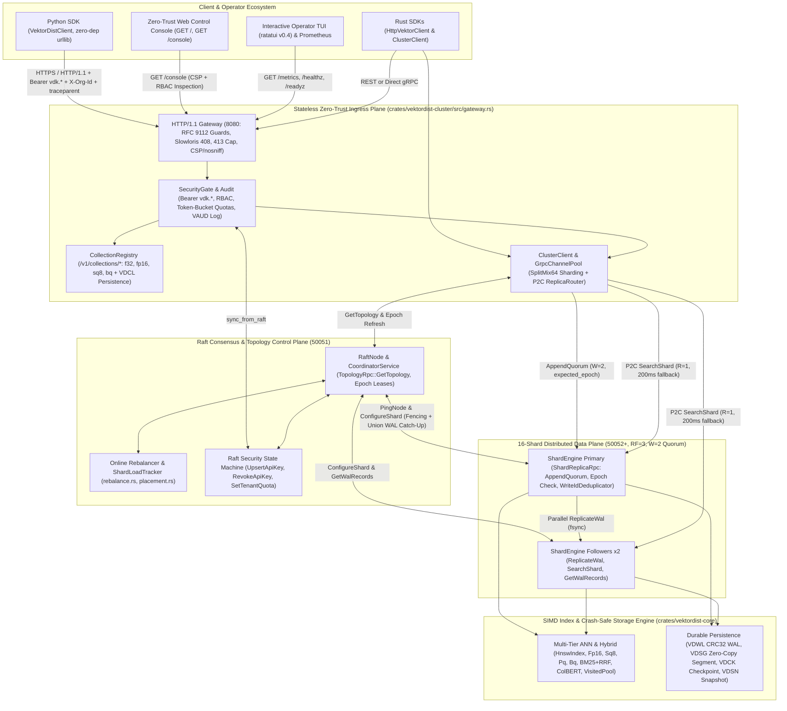
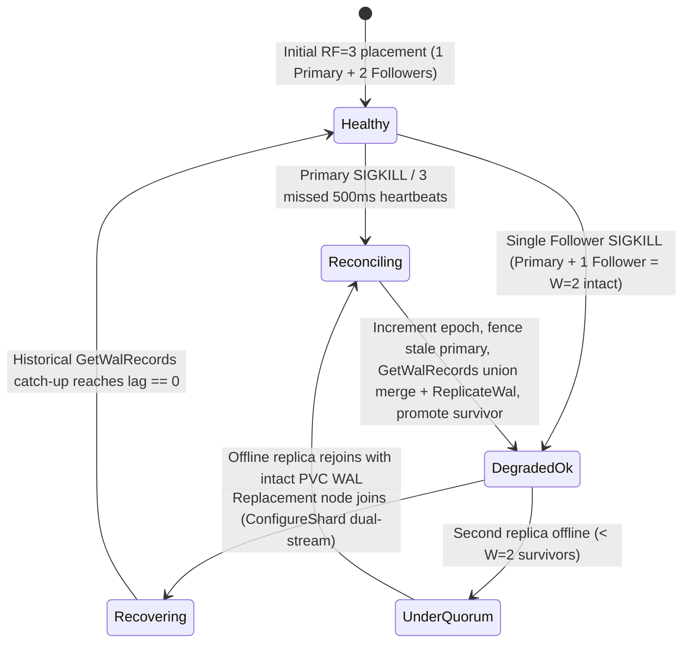

# VektorDist Enterprise System Architecture Reference

This document is the authoritative engineering reference for **VektorDist** (`v0.4.0`): a distributed, sharded HNSW vector and hybrid retrieval engine built in Rust from first principles. Every protocol invariant, binary wire header, consensus transition, quantization tier, and zero-trust security control documented below corresponds directly to workspace source modules and verified benchmarks.

---

## 1. System Context & Layered Container Architecture

VektorDist separates stateless ingress and authentication, Raft-replicated topology and security coordination, sharded quorum data-plane execution, and hardware-accelerated SIMD storage into four explicit planes:



### Workspace Crate Boundaries

| Crate / Target | Responsibility | Key Modules |
| :--- | :--- | :--- |
| **`vektordist` (root CLI/TUI)** | Declarative `VektorNodeConfig` (`VEKTORDIST_*`), `node`/`coord`/`gateway`/`keygen`/`snapshot`/`doctor`/`bench`/`bench-scale`/`chaos` CLIs, multi-process supervisor, and WCAG-accessible `ratatui` TUI (`[?]` help overlay, non-color status glyphs). | `src/main.rs`, `src/config.rs`, `src/tui.rs` |
| **`vektordist-proto`** | Protobuf `v1` wire contracts (`ShardReplicaRpc`, `TopologyRpc`) and checked-in `tonic`/`prost` stubs (zero `protoc` build requirement). | `proto/vektordist.proto`, `src/lib.rs` |
| **`vektordist-core`** | Contiguous arenas, `ARM NEON` & portable SIMD kernels, `HnswIndex` + `VisitedPool`, `FP16`/`SQ8`/`PQ`/`BQ` quantization, `PersistentVectorSegment`, `WalLog`, `ShardCheckpointManager`, BM25+RRF hybrid search, `AgentMemoryStore`, and `ColbertIndex`. | `arena.rs`, `simd.rs`, `hnsw.rs`, `fp16.rs`, `quant.rs`, `pq_bq.rs`, `mmap.rs`, `wal.rs`, `checkpoint.rs`, `hybrid.rs`, `agentic.rs`, `adaptive.rs` |
| **`vektordist-cluster`** | Raft consensus & security sync, shard rebalancing, `NodeService` (`ShardEngine`), `ClusterClient` (`GrpcChannelPool`, P2C routing), `CollectionRegistry` (`VDCL`), `SecurityGate` (`VAUD`), HTTP/1.1 gateway + Web Console, OpenAPI/Prometheus telemetry, and `ChaosCampaign`. | `raft.rs`, `rebalance.rs`, `coord.rs`, `node.rs`, `client.rs`, `placement.rs`, `collections.rs`, `security.rs`, `gateway.rs`, `telemetry.rs`, `backup.rs`, `chaos.rs`, `sdk.rs` |
| **`clients/python`** | Zero-dependency (`urllib`), `mypy --strict` & `ruff`-verified Python 3.11+/3.12+ SDK with finite-vector validation, `fp16` collection support, W3C `traceparent` injection, and bounded `429`/`503` backoff. | `vektordist_client.py`, `test_vektordist_client.py` |

---

## 2. Write Path & Consensus Guarantees (`RF=3`, `W=2`)

Every `VectorId` maps deterministically to one of `16` logical shards (`0..15`) via SplitMix64 hashing (`ClusterConfig::shard_for`). Under default production settings (`RF=3`, `W=2`), each shard maintains one epoch-leased primary and two followers. A mutation (`upsert`, `upsert_batch`, or `delete`) is acknowledged **if and only if** at least `W=2` replicas have durably `fsync`ed the CRC32-framed `VDWL` record to stable storage.

### End-to-End `W=2` Quorum Mutation Sequence

```mermaid
sequenceDiagram
    autonumber
    participant C as Client / Python SDK
    participant GW as HTTP/1.1 Gateway (SecurityGate)
    participant CC as ClusterClient (SplitMix64 + Pool)
    participant P as Shard Primary (ShardEngine)
    participant F1 as Follower Replica 1
    participant F2 as Follower Replica 2

    C->>GW: POST /v1/upsert (Bearer vdk.*, X-Org-Id, traceparent, write_id)
    GW->>GW: RFC 9112 framing check + NaN/Inf JSON scan + constant-time MAC
    GW->>GW: Verify Writer RBAC, token-bucket quota & append VAUD audit frame
    GW->>CC: upsert(id, vector, write_id)
    CC->>CC: shard_id = SplitMix64(id) % 16; lookup cached (primary_addr, epoch)
    CC->>P: gRPC AppendQuorum(shard_id, expected_epoch, WireWalRecord)

    alt expected_epoch < local_epoch
        P-->>CC: STATUS_WRONG_EPOCH(current_epoch)
        CC->>CC: Refresh topology via TopologyRpc::GetTopology & retry new primary
    else Epoch valid
        P->>P: Check WriteIdDeduplicator (FIFO 4,096 keys keyed by (write_id, op_tag))
        alt Duplicate retry hit
            P-->>CC: STATUS_OK(original assigned_seq_no) [Zero duplicate WAL write]
        else New write_id (or write_id == 0)
            P->>P: Assign gap-free seq_no, append VDWL CRC32 frame & fsync()
            par Parallel Follower WAL Replication
                P->>F1: gRPC ReplicateWal(shard_id, epoch, WireWalRecord)
                F1->>F1: Verify epoch >= local_epoch, append VDWL CRC32 & fsync()
                F1-->>P: ReplicateWalResponse(STATUS_OK, last_seq_no)
            and
                P->>F2: gRPC ReplicateWal(shard_id, epoch, WireWalRecord)
                F2->>F2: Verify epoch >= local_epoch, append VDWL CRC32 & fsync()
                F2-->>P: ReplicateWalResponse(STATUS_OK, last_seq_no)
            end
            P->>P: Confirm >= W=2 durable fsyncs (Primary + >= 1 Follower)
            P->>P: Commit to HnswIndex / VectorArena & record (write_id, op_tag) -> seq_no
            P-->>CC: AppendQuorumResponse(STATUS_OK, current_epoch, assigned_seq_no)
        end
    end
    CC-->>GW: UpsertAck(shard_id, seq_no)
    GW-->>C: 200 OK {"status":"ok","shard_id":...,"seq_no":...,"trace_id":...}
```

### Shard Replica Lifecycle & Zero-Loss Failover (`acknowledged_writes_lost == 0`)

Because `W=2` and `RF=3` satisfy strict quorum intersection ($W + R_{\text{failover}} = 2 + 2 = 4 > 3$), any `2` surviving replicas after a single-node `SIGKILL` are mathematically guaranteed to hold `100%` of acknowledged writes in the union of their WALs:



- **Epoch Lease Fencing (`STATUS_WRONG_EPOCH`):** Every `AppendQuorum` and `ReplicateWal` RPC carries `epoch: u64`. Any delayed packet from a partitioned or paused old primary with `epoch < local_epoch` is deterministically rejected before touching disk or memory.
- **Operation-Scoped Idempotency (`WriteIdDeduplicator`):** Each `ShardEngine` caches up to `4,096` committed `(WriteId, op_tag)` pairs (`op_tag` distinguishes `Upsert` vs `Delete`), preventing client retries after transient `503` or network timeouts from appending duplicate WAL frames while never conflating a delete retry with a prior upsert sharing an ID.
- **Fail-Closed Under-Quorum Protection (`ShardState::UnderQuorum`):** If two replicas of an `RF=3` shard fail simultaneously (`< W=2` survivors), `AppendQuorum` returns `STATUS_QUORUM_UNAVAILABLE` (`HTTP 503`) rather than acknowledging an under-replicated write, while `R=1` reads remain available on the surviving replica.

---

## 3. Distributed Scatter-Gather Read Path

1. **Power-of-Two-Choices (`P2C`) Replica Selection (`placement.rs` & `client.rs`):**
   - For each of the `16` shards, `ClusterClient` consults `AdaptiveRouter` / `ShardLoadTracker` (tracking per-node `in_flight_requests`, `ewma_qps`, and `ewma_latency_ms` with smoothing $\alpha = 0.3$).
   - Two healthy replicas are sampled and the lower-cost candidate is dispatched `SearchShard` (`R=1`) over a persistent HTTP/2 channel in `GrpcChannelPool`. If a replica times out (`200ms`) or returns a transport error, `ClusterClient` transparently fails over to a sibling replica within the same request budget.
2. **Zero-Allocation `VisitedPool` & Closed-Loop `AdaptiveSearchController` (`hnsw.rs`, `adaptive.rs`):**
   - Each `HnswIndex` and `Fp16HnswIndex` checks out a generation-stamped `VisitedTable` (`marks: Vec<u32>`, `gen: u32`) via RAII `VisitedGuard`, clearing visited state in $O(1)$ (`gen = gen.wrapping_add(1)`) without per-query `O(N)` heap allocations or cache-polluting memsets.
   - `AdaptiveSearchController` observes live latency percentiles and adjusts `ef_search` in closed loop—expanding beam width for higher recall when headroom exists and shedding beam cost smoothly under burst load to honor `p95` latency SLOs.
3. **One-Stage Filtered HNSW, BM25 + RRF Hybrid Fusion & Agentic Retrieval (`hybrid.rs`, `agentic.rs`):**
   - `MetadataFilter` (`Eq`, `In`, `Range`, `And`, `Or`) evaluates predicates **during** HNSW beam expansion inside per-`OrgId` sub-indices (`MultiTenantHybridEngine`), eliminating post-filter empty-result collapse at high filter selectivity.
   - Lexical `Bm25Index` candidates fuse with dense HNSW hits via Reciprocal Rank Fusion:
     $$\text{RRF}(d) = \sum_{r \in \{\text{dense}, \text{bm25}\}} \frac{1}{k_{\text{rrf}} + \text{rank}_r(d)}$$
   - `AgentMemoryStore` scores episodic memories by weighted cosine similarity + exponential recency decay + intrinsic importance under a greedy `max_token_budget` packer, paired with `ColbertIndex` token-level `MaxSim` late interaction and `(OrgId, filter_hash)`-partitioned `SemanticCache`.
4. **Bounded Sliding Telemetry (`telemetry.rs`):**
   - `BoundedLatencyWindow` maintains a fixed `1,024`-sample `VecDeque<f64>` ring buffer (`8 KiB` bounded RAM), feeding exact window `p50`, `p95`, and `p99` search latencies into Prometheus `/metrics` (`text/plain; version=0.0.4`).

---

## 4. On-Disk Binary Wire Formats & Crash Recovery

All persistent files use explicit 4-byte ASCII magic headers, little-endian integer encoding, IEEE 802.3 CRC32 (`crc32fast`) integrity verification, and POSIX write-to-temp + `fsync` + atomic `rename(2)` replacement where applicable.

| Magic | File Pattern | Binary Layout (Little-Endian) | Integrity & Crash-Recovery Semantics |
| :--- | :--- | :--- | :--- |
| **`VDWL`** | `shard-{id:04}.wal` (`WalLog`) | **16 B frame header:** `0..4` `b"VDWL"`, `4..8` `payload_len: u32`, `8..12` `crc32: u32` (over `op_kind` + payload), `12` `op_kind: u8` (`1`=Upsert, `2`=Delete), `13..16` `[0u8; 3]`. **Payload:** `seq_no: u64`, `write_id: u64`, `vector_id: u64`, plus `dims: u32` + `[f32; dims]` on Upsert. | Incomplete EOF header/payload or zeroed pre-allocation tail from `SIGKILL` is safely truncated (`set_len` + `sync_all`). Any interior CRC32 or header mismatch fails closed with `VektorError::WalCorruption { offset }`. |
| **`VDSG`** | `shard-{id:04}.vdsg` (`PersistentVectorSegment`) | **32 B header:** `0..4` `b"VDSG"`, `4..8` `version: u32` (`1`), `8..12` `dims: u32`, `12..16` `slot_count: u32`, `16..20` `live_count: u32`, `20..24` `tombstone_words: u32`, `24..32` `reserved: u64`. **Body:** `slot_ids` (`slot_count * 8 B`), `tombstones` (`tombstone_words * 8 B`), 8/64-bit aligned contiguous `f32` payload (`slot_count * dims * 4 B`). **Footer:** `4 B` `crc32: u32` over `0..len - 4`. | Backed by 64-bit word-aligned `AlignedSegmentBuffer` allowing zero-copy `&[f32]` slice borrowing without per-vector heap allocation. Full-file CRC32 verified on open; bit-rot returns `WalCorruption`. |
| **`VDCK`** | `shard-{id:04}.ckpt` (`ShardCheckpointManager`) | **Fixed 40 B manifest:** `0..4` `b"VDCK"`, `4..8` `version: u32` (`1`), `8..12` `shard_id: u32`, `12..16` `dims: u32`, `16..24` `checkpoint_seq_no: u64`, `24..32` `live_vectors: u64`, `32..36` `segment_crc32: u32`, `36..40` `ckpt_crc32: u32` (over `0..36`). | Protocol: `TieredCompactor` strips 100% of tombstones -> write/fsync `.vdsg.tmp` -> `rename` `.vdsg` -> write/fsync `.ckpt.tmp` -> `rename` `.ckpt` -> `WalLog::compact_to` via `.wal.compact.tmp` -> `fsync` -> `rename`. Cold recovery cross-checks `seg.crc32() == segment_crc32` and replays only `seq_no > checkpoint_seq_no`. |
| **`VDCL`** | `collections.vdcl` (`CollectionRegistry`) | **Header + Entries + Footer CRC32:** `b"VDCL"` magic, format version, collection count, per-collection `CollectionSpec` (`name`, `dimensions`, `metric`, `quantization` in `{f32, fp16, sq8, bq}`), tenant (`OrgId`) vector records, and trailing IEEE CRC32 checksum. | Persisted atomically via `collections.vdcl.tmp` -> `sync_all()` -> `rename("collections.vdcl")`. Ensures multi-collection schemas and `FP16`/`SQ8`/`BQ`/`F32` tenant vectors survive gateway restarts without torn writes. |
| **`VAUD`** | `audit.vaud` (`PersistentAuditLog`) | **12 B frame header:** `0..4` `b"VAUD"`, `4..8` `payload_len: u32`, `8..12` `crc32: u32`. **Payload:** serialized `AuditEntry` (`seq_no`, `timestamp_ms`, `actor_key_id`, `org_id`, `action`, `outcome`, `prev_hash`, `entry_hash` anchored at genesis `0` with domain tag `"AUDTCHN1"`). | Appended with `File::sync_data()` before updating memory. **Strict fail-closed forensic invariant:** unlike data WALs, even trailing truncation, frame deletion, or `seq_no`/`prev_hash` discontinuity raises `WalCorruption`. |
| **`VDSN`** | `manifest.bin` (`SnapshotManager`) | **28 B header:** `b"VDSN"`, `version: u32` (`1`), `node_id: u32`, `num_shards: u32`, `rf: u8`, `quorum: u8`, `metric: u8`, `pad: u8`, `dims: u32`, `shard_count: u32` + `40 B * shard_count` `ShardSnapshotEntry` (`wal_crc32`) + `4 B` `manifest_crc32`. | `vektordist snapshot verify` validates `manifest_crc32` and every `shard-XXXX.wal` byte length and IEEE CRC32 prior to touching a `--target-dir` during disaster recovery. |

---

## 5. Quantization & Index Tiering Decision Matrix

Measured on Apple M5 (`aarch64-apple-darwin`, `ARM NEON` 4x4-lane unrolled SIMD, `--release`, `seed = 42`; see [`docs/BENCHMARKS.md`](BENCHMARKS.md)):

| Index Tier | Precision / Kernel | Payload Bytes (`768d`) | Payload Compression | Measured `Recall@10` | Measured Latency (`768d`, `--release`) | Ideal Production Workload |
| :--- | :--- | :--- | :--- | :--- | :--- | :--- |
| **`ExactIndex`** | IEEE 754 `f32` (`4x4` NEON brute-force) | `3,072 B` | **1.0x** | `100.00%` (ground-truth oracle) | `p50 0.29 ms` / `p95 0.34 ms` (`3k`) | Small shards (`< 10k` vectors), live recall auditing (`LiveRecallEvaluator`), unit-test ground truth. |
| **`HnswIndex` (`f32`)** | IEEE 754 `f32` NEON + `VisitedPool` | `3,072 B` (`+ ~297 B` graph) | **1.0x** | **`100.00%`** (`3k`), `99.40%` (`64d`) | `p50 0.14 ms` / `p95 0.19 ms` (`3k`) | Latency-critical primary retrieval requiring maximum single-stage precision without calibration. |
| **`Fp16HnswIndex` (`fp16`)** | IEEE 754 `binary16` (`u16` 10-bit mantissa, 4-lane asymmetric `f32 x f16`) | `1,536 B` | **2.0x** | **`100.00%`** (`3k`, `>= 99%` without rerank) | `p50 0.53 ms` / `p95 0.59 ms` (`3k`) | Drop-in calibration-free **2x RAM cut** for high-dimensional (`768d–3072d`) multi-collection RAG & compliance search. |
| **`Sq8HnswIndex` (`sq8`)** | Affine `u8` + `vmovl_u8` widening NEON + `3x` rerank | `768 B` (`+ 6 KiB` table) | **4.0x** | `98.20%` pure / **`100.00%`** (`3x` rerank) | `p50 0.16 ms` / `p95 0.24 ms` (`3k`) | Default high-density production tier balancing **4x memory savings**, sub-millisecond NEON speed, and lossless-grade recall. |
| **`PqIndex` (`pq`)** | $M$ subspaces $\times$ `256` centroids (`u8` codes + `ADC` LUT) | `192 B` (at $M = 192$) | **16.0x** | High ANN recall (with optional `f32` rerank) | Sub-millisecond table lookup | Memory-constrained multi-million vector analytical/archival corpora where codebook training is acceptable. |
| **`BqIndex` (`bq`)** | 1-bit sign packed `[u64; 12]` (`XOR + POPCNT`) + exact/disk rerank | **`96 B`** | **32.0x** | **`100.00%`** (`10x–32x` rerank at `3k` & `1M`) | `p50 0.08 ms` (`3k`); **`p50 3.05 ms` / `p95 3.88 ms` at `1,000,000` (`328 MV/s`)** | Million-to-100M+ vector first-stage candidate generation (`91.55 MiB` for `1M x 768d`) paired with `VDSG` mmap reranking. |
| **`ColbertIndex`** | Multi-vector token embeddings + SIMD `MaxSim` $\sum_i \max_j (q_i \cdot d_j)$ | $T \times 4 \times D_{\text{tok}}\text{ B}$ | Token-level | Fine-grained lexical + semantic alignment | Two-stage candidate reranker | Legal, biomedical, code search, and `AgentMemoryStore` precision reranking over top-$K$ dense/hybrid candidates. |

---

## 6. Zero-Trust Security, Multi-Tenancy & Threat Model

VektorDist enforces defense-in-depth across authentication, multi-tenant isolation, HTTP/1.1 wire parsing, and forensic auditability (see [`docs/THREAT_MODEL.md`](THREAT_MODEL.md) and [`SECURITY.md`](../SECURITY.md)):

1. **Constant-Time Scoped `vdk.*` Credentials & Monotonic RBAC (`security.rs`):**
   - API keys follow `vdk.<key_id>.<64-hex-mac>` derived from the 256-bit `VEKTORDIST_MASTER_SECRET`, `key_id`, `OrgId`, monotonic `TenantRole` (`Reader < Writer < Admin`), and rotation `nonce`.
   - Verification uses branch-free `constant_time_eq_32` to eliminate timing side channels, and binds every `/v1/*` request to its authorized `X-Org-Id` (`401 Unauthorized` on bad/revoked token, `403 Forbidden` on cross-tenant `X-Org-Id` mismatch or insufficient role).
2. **Raft-Replicated Revocations & Quotas (`raft.rs`, `security.rs`):**
   - `UpsertApiKey`, `RevokeApiKey`, and `SetTenantQuota` (`max_qps_milli`, `burst_milli`, `max_vectors`, `max_memory_bytes`) replicate via Raft so every horizontally scaled `HttpGatewayServer` enforces identical instant revocations, `429 Too Many Requests` (`Retry-After`), and `507 Insufficient Storage` ceilings.
3. **RFC 9112 Request-Smuggling & Adversarial Input Hardening (`gateway.rs`):**
   - **HTTP Desync / Smuggling Prevention:** Any request containing `Transfer-Encoding` (e.g., `chunked` `CL.TE` / `TE.CL` smuggling vectors) or multiple conflicting `Content-Length` headers is deterministically rejected before body parsing.
   - **Adversarial JSON & Path Traversal Guards:** String-aware JSON field scanning prevents payload values containing escaped quotes/keys from spoofing top-level fields; non-finite floats (`NaN`, `Infinity`, `-Infinity`) are rejected at both SDK (`_coerce_finite_vector`) and gateway boundaries (`400 Bad Request`); percent-decoded URL paths reject `..` / `%2e%2e` traversal segments before touching `CollectionRegistry`.
4. **Connection Exhaustion, Slowloris & Browser Hardening:**
   - Bounded concurrency (`tokio::sync::Semaphore`, default `512` permits), Slowloris header/body read deadlines (`408 Request Timeout`, default `5s`), and strict `max_body_bytes` caps (`413 Payload Too Large`) protect node memory and file descriptors.
   - Every HTTP response emits hardened security headers (`X-Content-Type-Options: nosniff`, `X-Frame-Options: DENY`, `Cache-Control: no-store`), CORS preflight (`OPTIONS`) controls, and a strict `Content-Security-Policy` (`default-src 'none'; script-src 'unsafe-inline'; style-src 'unsafe-inline'; connect-src 'self'`) on the zero-dependency Accessible Web Control Console (`GET /`, `GET /console`).
5. **Tamper-Evident Persistent Audit Trail (`VAUD`):**
   - Every permitted and denied gateway action appends a hash-chained `AuditEntry` (`prev_hash -> entry_hash`) to `PersistentAuditLog` with `fsync` durability, continuously verifiable online via `GET /v1/audit` (`Admin` role).
